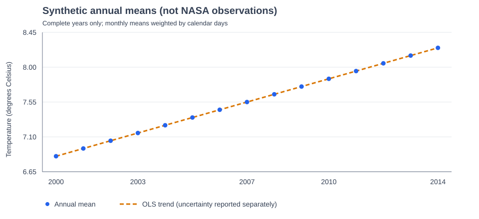

# ARCES

**Analysis of Regional Change in Earth Systems**

A C++20 tool for extracting NASA MERRA-2 temperature records, building monthly and
annual time series, and estimating environmental trends at a selected grid location.

Inspired by the [NASA Space Apps Earth System Trend Detective challenge](https://www.spaceappschallenge.org/2026/challenges/earth-system-trend-detective/).
ARCES is an independent project, not affiliated with or endorsed by NASA.

## What works now

The **0.3.0 development milestone** implements the path from monthly NetCDF data
through trend analysis:

- Read `T2M` at the nearest latitude-longitude grid location.
- Decode supported time metadata and export dated CSV records.
- Combine a directory of monthly files, or all time steps in one file.
- Sort by dates; reject duplicate months and changing selected grid coordinates.
- Decode packed temperatures and flag missing or out-of-range values.
- Report gaps and incomplete years without filling missing observations.
- Calculate calendar-day-weighted annual means from 12 valid months.
- Fit a linear trend in degrees Celsius per decade.
- Report approximate 95% HAC confidence intervals, approximate p-values, fit quality,
  and a residual-correlation diagnostic.
- Export CSV/JSON plus an offline HTML report and SVG chart.
- Test the entire pipeline with synthetic data; no NASA account is needed for tests.

Province-wide GIS processing, boundary clipping, and interactive maps are future work.

## Quick start: Windows

Requirements: Visual Studio 2022 Build Tools with C++/Windows SDK, CMake 3.24+,
Git, and vcpkg. VS Code with C/C++ and CMake Tools extensions is recommended.

```powershell
git clone https://github.com/RipLiquid/ARCES.git
cd ARCES
```

If you do not already have vcpkg:

```powershell
git clone https://github.com/microsoft/vcpkg.git "$env:USERPROFILE\vcpkg"
$env:VCPKG_ROOT = "$env:USERPROFILE\vcpkg"
```

If it is already installed, set `VCPKG_ROOT` to its folder instead. The project pins
the package definitions to a Git revision. In a clean vcpkg checkout, use:

```powershell
$revision = (Get-Content .\vcpkg-commit.txt -Raw).Trim()
git -C "$env:VCPKG_ROOT" checkout --detach $revision
& "$env:VCPKG_ROOT\bootstrap-vcpkg.bat" -disableMetrics
```

Build and test:

```powershell
.\scripts\build.ps1
```

The helper can also locate vcpkg beside ARCES or in your user folder. If your
PowerShell policy prevents scripts, use the equivalent commands:

```powershell
cmake --preset windows-static
cmake --build --preset static-debug --parallel
ctest --preset static-debug
```

Release build: `.\scripts\build.ps1 -Configuration Release`, or use the
`static-release` build and test presets after configuring.

## Try a complete analysis without downloading data

```powershell
.\scripts\demo.ps1
```

This generates 15 years of **synthetic** monthly data, analyzes it, and prints a
path to `report.html`. Open that file in a browser. The known **1 C/decade** trend
is deliberately constructed for demonstration; it is not an observed NASA result.
The script creates a new result folder each time and preserves previous reports.



The committed [example report](examples/synthetic/report.html) and
[statistics](examples/synthetic/trend.json) are synthetic as well. Download/open
the HTML locally; GitHub displays its source rather than running the report.

## Use NASA data

Use [MERRA-2 monthly single-level diagnostics, M2TMNXSLV v5.12.4](https://doi.org/10.5067/AP1B0BA5PD2K),
variable `T2M` (air temperature at 2 metres, kelvin). MERRA-2 is a model-and-observation
reanalysis with approximately 0.5 degree latitude by 0.625 degree longitude spacing.
It is not a street-level or weather-station dataset.

1. Sign in to [Earthdata](https://urs.earthdata.nasa.gov/).
2. Open the collection's **Data Access → Earthdata Search** option.
3. Download the selected monthly `.nc4` files to `data/raw/`.
4. Keep original filenames and collection citations. Never commit access tokens.

The intended Ontario case-study period is January 1995–December 2024. Those 360
monthly files are **not included or downloaded automatically**. A single monthly
file can demonstrate extraction but cannot support an annual trend.

### Extract one file

```powershell
.\build\windows-static\Debug\arces.exe "data/raw/MERRA2_200.tavgM_2d_slv_Nx.199501.nc4" 43.65 -79.38
```

For the January 1995 sample, the selected grid coordinate is **43.5, -79.375** and
the extracted mean is approximately **271.409 K / -1.7414 C**. The decoded timestamp
is `1995-01-01T00:30:00`; it labels the monthly record, not an instantaneous reading.

Supply a new filename to export all time steps in that input file:

```powershell
.\build\windows-static\Debug\arces.exe "data/raw/MERRA2_200.tavgM_2d_slv_Nx.199501.nc4" 43.65 -79.38 "build/toronto-january.csv"
```

### Analyze a time series

```powershell
.\build\windows-static\Debug\arces.exe analyze "data/raw" 43.65 -79.38 --start 1995-01 --end 2024-12 --output "results/toronto-1995-2024"
```

`analyze` accepts a single file or a directory; directory discovery is nonrecursive
and includes `.nc`, `.nc4`, and `.cdf`. All matching files must be compatible monthly
products. Windows are inclusive. Unsupported or malformed files fail explicitly.

Output directories must be new. ARCES does not intentionally overwrite existing
outputs. Single-file CSV export requires an existing parent folder. All paths are
resolved relative to the current working directory unless absolute.

| Output | Contents |
|---|---|
| `monthly.csv` | Timestamp, selected coordinates, kelvin/Celsius, status, input source |
| `annual.csv` | Coverage, valid days, complete-year mean, partial mean, fitted value |
| `gaps.csv` | Missing calendar months and invalid/missing observations |
| `trend.json` | Trend, uncertainty, coverage, method, warnings |
| `annual-trend.svg` | Exportable annual-mean and fitted-trend chart |
| `report.html` | Offline summary with chart and links to result files |

The default minimum is **10 complete years**. With less data, exports still succeed,
but `trend.json` says `insufficient_data` and trend statistics are null. Do not treat
a successful process exit as proof that a trend was estimated.

Additional options:

```text
--start YYYY-MM    First included calendar month
--end YYYY-MM      Last included calendar month
--min-years N     Minimum complete years (>=3; default 10)
--hac-lag N       Nonnegative calendar-year lag limit; automatic if omitted
```

Exit code `0` indicates a completed operation; `1` indicates invalid input or failure.

## Testing and project layout

Seven CTest groups cover CLI errors, NetCDF fixture creation/extraction, timestamp
conversion, annual/statistical calculations, and full multi-file exports. Within
those groups are checks for leap years, missing months, duplicates, fill markers,
packing, output preservation, known trends, and independent regression constants.

GitHub Actions builds and tests Debug and Release on Windows. Its job name remains
**Windows build and test** so it can be required by the main-branch ruleset.

```text
src/       CLI, NetCDF reader, time conversion, analysis core
tests/     C++ tests, synthetic data generators, CLI integration tests
scripts/   Windows build/test and synthetic demo helpers
docs/      Analysis methods and limitations
examples/  Synthetic example outputs; not NASA measurements
tools/     Optional independent Python statistical reference
```

## Data attribution

Global Modeling and Assimilation Office & Pawson, S. (2015). *MERRA-2 monthly mean
single-level diagnostics, V5.12.4*. NASA Goddard Earth Sciences Data and Information
Services Center. https://doi.org/10.5067/AP1B0BA5PD2K

NetCDF/HDF5 and Boost Math are external dependencies with their own licenses. This
repository does not currently grant a project-wide open-source license; choose one
before distributing it as licensed open-source software.
