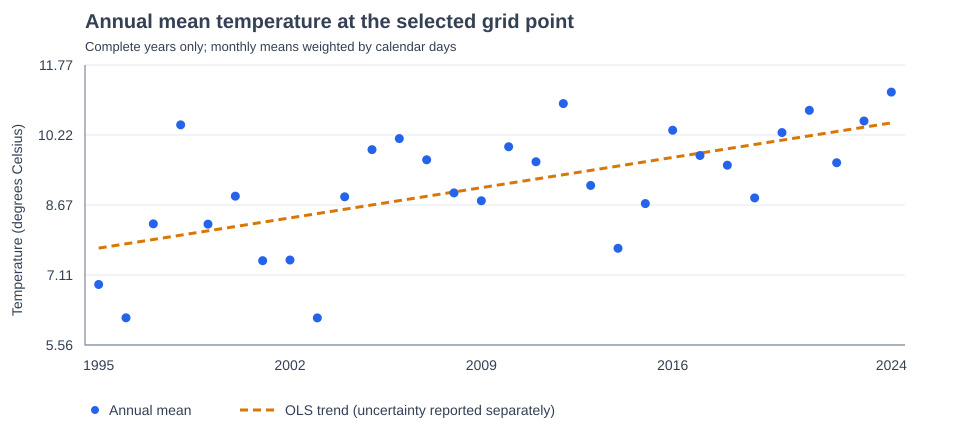

# Temperature trends near Toronto, 1995–2024

This case study uses ARCES v0.3.0 to analyze 360 monthly MERRA-2
temperature records covering January 1995 through December 2024.

## Data and location

- Dataset: NASA MERRA-2 M2TMNXSLV, version 5.12.4.
- Variable: T2M, 2-metre air temperature, converted from kelvin to Celsius.
- Requested coordinates: 43.65° N, 79.38° W.
- Selected grid coordinates: 43.5° N, 79.375° W.
- Coverage: 360 valid months and 30 complete years, with no missing months.

The result describes one reanalysis grid point near Toronto. It is not
a city-wide average or a weather-station measurement.

## Method and result

Annual means weight monthly temperatures by calendar days and require
all 12 valid months. An ordinary least-squares regression estimates the
trend from complete annual means.

The estimated trend is **+0.959 °C per decade**, with an approximate
95% Newey–West HAC interval of **[0.538, 1.379] °C per decade**.
The default HAC lag is 3 calendar years. The approximate p-value is
0.0000681, and R² is 0.393.

## Sensitivity to HAC lag

| Lag (years) | Trend (°C/decade) | Approximate 95% interval |
|---|---|---|
| 0 | 0.9586 | [0.5005, 1.4166] |
| 1 | 0.9586 | [0.4567, 1.4604] |
| 3 | 0.9586 | [0.5382, 1.3789] |
| 5 | 0.9586 | [0.6479, 1.2692] |

All four intervals exclude zero. These checks assess sensitivity to
HAC lag; they do not establish robustness to every modeling choice.

## Validation and limitations

An independent Python calculation reproduced the 30 calendar-day-weighted
annual means and the OLS slope of 0.9585657996 °C per decade.
The HAC uncertainty estimates were not independently reproduced for
this case study.

This is an exploratory estimate for one location and time period.
It does not establish causation or provide a forecast. Confidence
intervals and p-values use approximate inference.

## Included outputs

- [Annual means](annual.csv)
- [Trend statistics and analysis settings](trend.json)
- [Missing-month report](gaps.csv)
- [Trend chart](annual-trend.svg)

Raw NetCDF downloads are excluded from the repository.

## Data source

NASA Global Modeling and Assimilation Office (GMAO), MERRA-2 monthly
single-level diagnostics, version 5.12.4:
https://doi.org/10.5067/AP1B0BA5PD2K